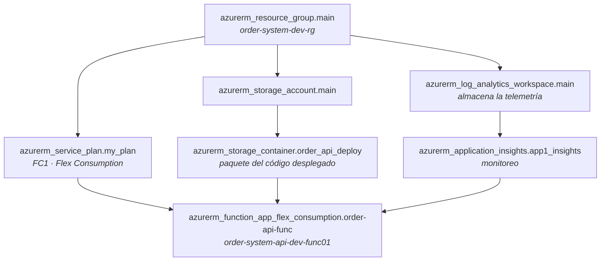

# Infraestructura (Terraform)

## Dos niveles de recursos

| Nivel | Recursos | Quién lo crea | ¿Se puede borrar y recrear? |
|---|---|---|---|
| **Backend** (state de Terraform) | RG `serverless-rg`, storage `tfstateserverless01`, contenedor `tfstate` | `az` CLI, una sola vez | **No.** Se crea una vez y no se toca. |
| **Infra de la app** | Todo lo declarado en `main.tf` (RG `order-system-dev-rg`, service plan, storage, etc.) | Terraform | Sí, con `terraform destroy` / `terraform apply` las veces que quieras. |

## ¿Por qué el backend se crea con `az` y no con Terraform?

`backend.tf` no crea recursos: le indica a Terraform **dónde guardar su state**, el
archivo con el que Terraform recuerda qué recursos creó y cómo.

`terraform init` se conecta a ese storage como primer paso, antes de leer `main.tf`.
Si el storage no existe, Terraform no arranca. Terraform no puede crear el lugar
donde guarda su propia memoria porque lo necesita para funcionar: es un problema de
**huevo y gallina**. Por eso el backend se crea por fuera (con `az`) antes del primer
`terraform init`.

## Paso 1: crear el backend (solo la primera vez)

```bash
az group create -n serverless-rg -l eastus

az storage account create -n tfstateserverless01 -g serverless-rg -l eastus \
  --sku Standard_LRS --min-tls-version TLS1_2 --allow-blob-public-access false

az storage container create -n tfstate --account-name tfstateserverless01 --auth-mode login
```

- Los nombres deben coincidir con `backend.tf`.
- El nombre del storage account es único en todo Azure. Si está ocupado (por ejemplo,
  porque se acaba de borrar y Azure aún no lo libera), usa otro y actualiza `backend.tf`.
- Si el último comando falla por permisos, `--auth-mode login` requiere el rol
  *Storage Blob Data Contributor*. Usa `--auth-mode key` en su lugar.

## Paso 2: inicializar Terraform

```bash
cd infra
terraform init
```

Si el backend se recreó y `.terraform/` todavía apunta a la configuración anterior,
usa `terraform init -reconfigure`.

## Paso 3: crear o actualizar la infraestructura

```bash
terraform plan
terraform apply
```

## Cómo lee Terraform los archivos y en qué orden crea los recursos

### Los archivos se unen en una sola configuración

`terraform plan` y `terraform apply` cargan **todos los `.tf` de esta carpeta**
(`main.tf`, `function-app-order-api.tf`, `variables.tf`, `outputs.tf`, ...) y los
tratan como si fueran un solo archivo. El nombre y el orden de los archivos **no
importan**: dividirlos es solo para organizarse. Las subcarpetas no se leen, salvo
que se usen como `module`.

### El orden lo decide el grafo de dependencias

Cuando un recurso referencia un atributo de otro (por ejemplo
`resource_group_name = azurerm_resource_group.main.name`), Terraform deduce que
debe crear primero el referenciado. Con esas referencias arma este grafo. Cada
flecha significa "se crea antes que":



Al ejecutar un `apply` sobre un ambiente vacío:

1. **Resource group:** no depende de nada, así que va primero.
2. **Service plan, storage account y Log Analytics, en paralelo:** solo dependen
   del RG y no entre sí. Terraform ejecuta hasta 10 operaciones a la vez.
3. **Container y App Insights:** cada uno espera a su padre (storage y workspace).
4. **Function App al final:** referencia al plan, al container y a App Insights.

`terraform destroy` recorre el grafo **al revés**: primero la Function App y al
final el RG.

> El grafo muestra solo las dependencias directas mínimas. La Function App también
> referencia al storage account y al RG, pero esas dependencias ya quedan cubiertas
> a través del container y del plan, así que Terraform las omite del diagrama.

Si un recurso necesita a otro sin referenciar ninguno de sus atributos, la
dependencia se declara a mano con `depends_on = [...]`. Es la excepción: lo
normal es que basten las referencias.

Para regenerar el grafo desde el código (requiere `brew install graphviz`):

```bash
terraform graph | dot -Tpng > grafo.png
```

## Borrar todo: siempre con Terraform, nunca desde el portal

```bash
terraform destroy
```

`terraform destroy` borra solo la infra de la app, deja el backend intacto y mantiene
el state consistente. Después, un `terraform apply` vuelve a crear todo.

Si se borra desde el portal:
- el state queda desincronizado: dice que existen recursos que ya no están;
- si se borra también `serverless-rg`, se pierde el backend y hay que repetir el Paso 1.

## Requisito de la suscripción: registrar namespaces (una sola vez)

Cada tipo de recurso de Azure pertenece a un namespace (*resource provider*) que debe
estar registrado en la suscripción. Si no lo está, `terraform plan` sale bien pero
`terraform apply` falla con `MissingSubscriptionRegistration`.

| Namespace | Recursos que lo usan |
|---|---|
| `Microsoft.Web` | App Service Plan, Function Apps |
| `Microsoft.Storage` | Storage accounts |
| `Microsoft.OperationalInsights` | Log Analytics Workspace |
| `Microsoft.Insights` | Application Insights |

Para revisar el estado de todos:

```bash
for ns in Microsoft.Web Microsoft.Storage Microsoft.OperationalInsights Microsoft.Insights; do
  printf "%-32s %s\n" $ns "$(az provider show -n $ns --query registrationState -o tsv)"
done
```

Para registrar los que digan `NotRegistered`:

```bash
az provider register --namespace Microsoft.Web --wait
az provider register --namespace Microsoft.Storage --wait
az provider register --namespace Microsoft.OperationalInsights --wait
az provider register --namespace Microsoft.Insights --wait
```

El registro es de la suscripción, no de un recurso: borrar recursos no lo deshace.
Si agregas un tipo de recurso nuevo y aparece `MissingSubscriptionRegistration`,
el mensaje de error indica el namespace: regístralo y agrégalo a esta tabla.

## Service principal para GitHub Actions (una sola vez)

Para que GitHub Actions ejecute `terraform plan` y `terraform apply`, necesita una
identidad propia en Azure: un **service principal**, que es una "cuenta de servicio"
en Entra ID. En local Terraform usa tu sesión de `az login`, pero un pipeline no
puede iniciar sesión como tú.

```bash
az ad sp create-for-rbac --name github-terraform-deployer --role Contributor \
  --scopes "/subscriptions/$(az account show --query id -o tsv)"
```

| Parte | Qué hace |
|---|---|
| `--name github-terraform-deployer` | Crea (o reutiliza) la app en Entra ID con ese nombre |
| `--role Contributor` | Le da permiso para crear, modificar y borrar recursos |
| `--scopes /subscriptions/<id>` | Limita ese permiso a esta suscripción |

### Qué devuelve y dónde va

La salida es un JSON con credenciales. **Cópialo directo a los secrets del repo**
(GitHub → *Settings* → *Secrets and variables* → *Actions*) y no lo pegues en chats
ni lo commitees:

| Campo de la salida | Secret en GitHub | Para qué |
|---|---|---|
| `appId` | `ARM_CLIENT_ID` | Identifica al service principal |
| `password` | `ARM_CLIENT_SECRET` | Su contraseña |
| `tenant` | `ARM_TENANT_ID` | El directorio (tenant) de Entra ID |
| *(no viene en la salida)* `az account show --query id -o tsv` | `ARM_SUBSCRIPTION_ID` | La suscripción donde se despliega |

El provider `azurerm` y el backend leen automáticamente estas variables `ARM_*` del
entorno, así que en el workflow basta con exponerlas como variables de entorno.

### Errores y advertencias conocidos

- **`(MissingSubscription) The request did not have a subscription...`:** el scope
  está mal escrito. Es `/subscriptions/` (con **s**), no `/subcriptions/`. Usar
  `$(az account show ...)` evita tipear la ruta.
- **`Found an existing application instance ... We will patch it`:** la app ya existe
  (por ejemplo, de un intento fallido) y se reutiliza. Se genera un `password` nuevo:
  usa siempre el de la **última** ejecución y actualiza el secret en GitHub.
- **El `password` vence** (por defecto en un año). Cuando venza, el pipeline fallará
  con un error de autenticación. Para regenerarlo:
  `az ad sp credential reset --id <appId>`.
- **`Contributor` no puede asignar roles.** Si en el futuro Terraform crea
  *role assignments* (por ejemplo, dar a la Function App acceso al storage con
  managed identity), el service principal necesitará además
  *Role Based Access Control Administrator* o *User Access Administrator*.

### Alternativa más segura: OIDC

En vez de un `password` guardado en GitHub, se pueden usar *federated credentials*
(OIDC): GitHub obtiene un token temporal de Azure en cada ejecución y no hay ningún
secreto que guardar ni que rote. Es lo que recomiendan Microsoft y GitHub para
pipelines nuevos.
